# Data model

Entity relationship diagram of the live schema, built from `supabase/migrations/0001` to `0017` (23 Oct 2026). GitHub renders the diagram below.

Not shown: `0007`/`0008` (GymMaster, unmerged branch), which add `leads.gymmaster_member_id`, a `gymmaster_api` lead source and a `gymmaster_sync_log` table. The `trainer-documents` Storage bucket holds the files `trainer_documents.file_path` points at.

Update this when a migration adds or changes a table.

```mermaid
erDiagram
    auth_users ||--o| profiles : "logs in as"
    trainers |o--o{ profiles : "linked login"

    trainers ||--o{ leads : "allocated"
    trainers |o--o{ leads : "requested by member"
    leads ||--o{ status_history : "status changes"

    trainers ||--o{ onboarding_responses : "workbook answers"
    trainers ||--o{ onboarding_part_status : "part progress"

    document_types ||--o{ trainer_documents : "classifies"
    trainers ||--o{ trainer_documents : "uploads"
    trainer_documents ||--o{ document_reminders : "expiry reminders"

    trainers ||--o{ development_goals : "sets"
    trainers ||--o{ development_notes : "receives"
    development_goals |o--o{ development_notes : "about"

    trainers ||--o| trainer_setup_checklists : "setup header"
    trainers ||--o{ trainer_setup_checklist_items : "ticks off"
    setup_checklist_items ||--o{ trainer_setup_checklist_items : "template for"

    auth_users {
        uuid id PK "Supabase Auth"
        text email
    }
    profiles {
        uuid id PK,FK "= auth.users.id"
        app_role role "manager | trainer | staff"
        uuid trainer_id FK "required unless manager"
        text full_name
        timestamptz created_at
    }
    trainers {
        uuid id PK
        text name
        text email
        trainer_gender gender "male | female"
        text_array specialties
        boolean available_am "both off = leads paused"
        boolean available_pm
        boolean active "false for staff"
        text bio
        timestamptz created_at
    }
    leads {
        uuid id PK
        text name
        text phone
        text email
        date date_of_birth
        text_array goals "required for form leads"
        text goal_other
        text current_exercise
        gender_preference gender_preference
        time_preference time_preference
        uuid preferred_trainer_id FK
        text contact_preference
        lead_source lead_source "form | gymmaster_sweep"
        uuid allocated_trainer_id FK
        lead_status status "New to Completed"
        text notes
        timestamptz first_contact_due_at "created + 48h"
        timestamptz first_contacted_at
        uuid created_by FK "auth.users"
        text ip_hash
        timestamptz deleted_at "soft delete"
        timestamptz created_at
    }
    status_history {
        uuid id PK
        uuid lead_id FK
        lead_status old_status
        lead_status new_status
        uuid changed_by FK "auth.users"
        timestamptz changed_at
    }
    rate_limit_log {
        bigint id PK
        text ip_hash "public form throttle"
        timestamptz created_at
    }
    onboarding_responses {
        uuid id PK
        uuid trainer_id FK
        int part_number "1 to 10"
        text activity_key "stable, never rename"
        text response
        timestamptz updated_at
    }
    onboarding_part_status {
        uuid trainer_id PK,FK
        int part_number PK
        text status "not_started | in_progress | complete"
        timestamptz completed_at
        timestamptz updated_at
    }
    document_types {
        uuid id PK
        text key UK "e.g. contract"
        text label
        document_expiry_rule expiry_rule "none | optional | required"
        boolean active
        int sort_order
        boolean is_custom
    }
    trainer_documents {
        uuid id PK
        uuid trainer_id FK
        uuid document_type_id FK
        text custom_label
        text file_path "trainer-documents bucket"
        text file_name
        bigint file_size
        text mime_type
        date expiry_date
        document_status status "pending | verified | rejected"
        text rejection_reason
        uuid verified_by FK "auth.users"
        timestamptz verified_at
        uuid uploaded_by FK "auth.users"
        timestamptz uploaded_at
    }
    document_reminders {
        uuid id PK
        uuid document_id FK
        text milestone "60 | 30 | 7 | expired"
        date sent_on
    }
    development_goals {
        uuid id PK
        uuid trainer_id FK
        text title
        text detail
        development_goal_status status "active | achieved | parked"
        date target_date
        timestamptz achieved_at
    }
    development_notes {
        uuid id PK
        uuid trainer_id FK
        uuid goal_id FK "same trainer as goal"
        text body
        uuid author_id FK "auth.users"
        timestamptz created_at
    }
    setup_checklist_items {
        uuid id PK
        text key UK
        text label
        text hint
        int sort_order
        boolean active
    }
    trainer_setup_checklists {
        uuid trainer_id PK,FK
        date start_date
        text amendments
        timestamptz completed_at
    }
    trainer_setup_checklist_items {
        uuid trainer_id PK,FK
        uuid item_id PK,FK
        setup_item_state state "pending | done | not_applicable"
        text note
        uuid updated_by FK "auth.users"
        timestamptz updated_at
    }
```

